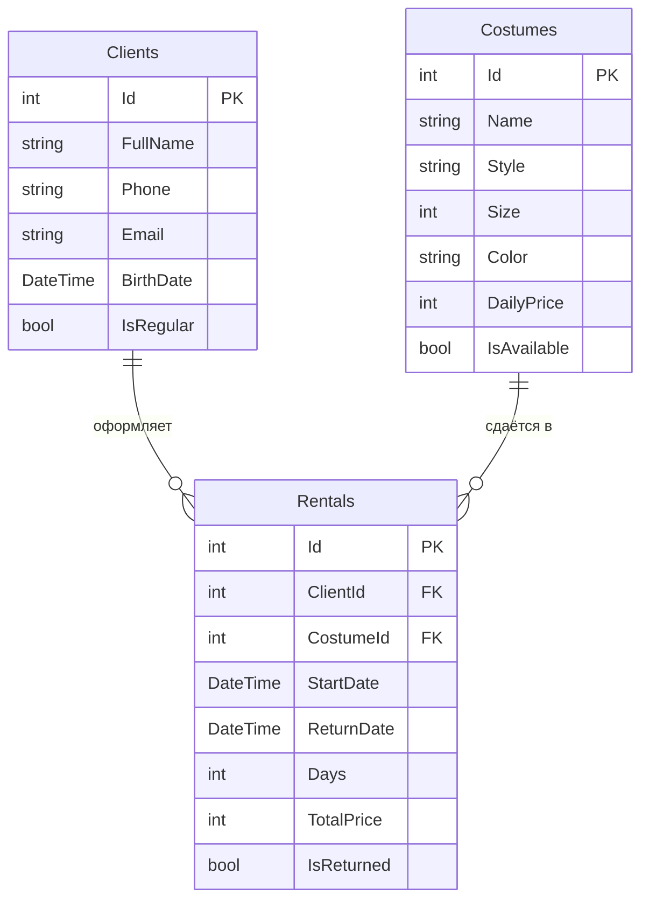

# StyleRent

Приложение для учёта клиентов, костюмов и аренд в студии проката образов.

## Автор

Жириков Юрий, группа РПО-24/1

## О проекте

**Тема:** прокат.

**Заведение:** «StyleRent» — студия проката костюмов и вечерних нарядов для фотосессий, вечеринок, косплея и выпускных. Администратор студии ведёт учёт клиентов, следит за тем, какие костюмы свободны, и записывает, кто и на сколько дней взял образ. От обычного проката одежды студию отличает то, что у каждого костюма есть стиль (например, «элегантный», «винтаж», «косплей») и размер, а сумма аренды зависит от суточной цены костюма и числа дней. Приложением будут пользоваться администраторы студии, чтобы быстро подобрать клиенту свободный образ и не потерять костюмы.

## Схема базы

## Таблицы

### Clients

В таблице хранятся клиенты студии, которые берут костюмы напрокат.

| Поле | Тип | Обязательное | Описание |
|------|-----|--------------|----------|
| Id | int | да | Первичный ключ, уникальный номер клиента |
| FullName | string | да | Фамилия, имя и отчество клиента |
| Phone | string | да | Телефон для связи |
| Email | string | нет | Адрес электронной почты |
| BirthDate | DateTime | нет | Дата рождения |
| IsRegular | bool | да | Постоянный клиент (да) или нет |

### Costumes

В таблице хранятся костюмы и наряды, которые студия сдаёт в аренду.

| Поле | Тип | Обязательное | Описание |
|------|-----|--------------|----------|
| Id | int | да | Первичный ключ, уникальный номер костюма |
| Name | string | да | Название костюма, например «Бархатное платье Версаль» |
| Style | string | да | Стиль образа: элегантный, винтаж, косплей и т. д. |
| Size | int | да | Российский размер одежды |
| Color | string | нет | Основной цвет костюма |
| DailyPrice | int | да | Цена аренды за сутки, в рублях |
| IsAvailable | bool | да | Свободен ли костюм сейчас (да) или находится в аренде (нет) |

### Rentals

Связующая таблица: в ней записано, какой клиент, какой костюм и на какой срок взял.

| Поле | Тип | Обязательное | Описание |
|------|-----|--------------|----------|
| Id | int | да | Первичный ключ, уникальный номер аренды |
| ClientId | int | да | Внешний ключ на Clients.Id: кто арендовал |
| CostumeId | int | да | Внешний ключ на Costumes.Id: что арендовали |
| StartDate | DateTime | да | Дата и время начала аренды |
| ReturnDate | DateTime | нет | Дата возврата костюма; пусто, пока костюм не возвращён |
| Days | int | да | Количество суток аренды |
| TotalPrice | int | да | Итоговая сумма аренды, в рублях |
| IsReturned | bool | да | Возвращён ли костюм в студию |

## Связи

- **Clients → Rentals** (один ко многим): у клиента может быть много аренд, а каждая аренда относится ровно к одному клиенту. Связь идёт через внешний ключ `Rentals.ClientId`.
- **Costumes → Rentals** (один ко многим): один костюм сдают много раз в разное время, а в каждой аренде записан один костюм. Связь идёт через внешний ключ `Rentals.CostumeId`.
- **Clients ↔ Costumes** (многие ко многим): один клиент берёт много костюмов, а один костюм берут многие клиенты. База не хранит такую связь напрямую, поэтому для неё нужна связующая таблица `Rentals`. Каждая её запись соединяет одного клиента с одним костюмом и добавляет данные об аренде: даты, срок и сумму.
